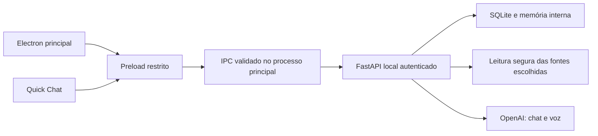

# DOCUMENT — Referência técnica do JARVIS 1.0.1

Este documento descreve a implementação existente. O [README](README.md) orienta instalação e uso; o [IDEIA](IDEIA.md) registra a visão e as propostas futuras.

## Arquitetura e limites de confiança



O renderer não recebe o token nem lê o sistema de arquivos. Cadastro, remoção e confirmações humanas usam IPC próprio. O backend continua limitado ao loopback. O projeto analisado é uma fonte de dados não confiáveis, sem capacidade de conceder permissões ou executar ações.

## Organização do código

- `desktop/styles/`: tokens, layout, mensagens/compositor, diálogos e responsividade; `app.css` é o ponto de entrada.
- `desktop/ui.js`: apresentação, Markdown sanitizado, preferências, diálogos e acessibilidade.
- `desktop/workspace.js`: navegação e estado por IDs de projeto/chat; `scope.js`: seleção de fontes.
- `desktop/renderer.js`: chat, reprodução e controles locais; não executa código recebido.
- `desktop/main.js`: janelas, IPC validado e ciclo de vida; `backend-runtime.js`: supervisão exclusiva do backend empacotado.
- `desktop/quick-*`: janelas auxiliares, geometria, temporizador e interação, independentes da principal.
- `backend/main.py`: composição da aplicação e endpoints; módulos de armazenamento, indexação e políticas mantêm responsabilidades próprias.
- `start.py`: iniciador de desenvolvimento; `tools/build_release.py`: pipeline Windows; `backend/packaged_entry.py`: entrada do backend congelado.

Foi mantido JavaScript modular: a aplicação já possui separação funcional e testes, sem exigir uma migração de framework para esta revisão visual. Prettier formata o frontend e Black o Python. A formatação não substitui validação funcional nem muda os contratos da API ou o esquema dos bancos.

## Design da versão 1.0

Mantidos tema escuro, ciano, moldura nativa, sidebar e largura de leitura. Refinados contraste dos textos de apoio, truncamento dos títulos, indicação do item ativo, foco da busca, hierarquia de títulos, tabelas e cópia no cabeçalho dos blocos de código. A janela mínima de 800×560 reorganiza sugestões e o status do projeto. Diálogos possuem nomes acessíveis. O Quick Chat mantém ícone de 42 px, transparência constante, padding de 12 px e pausa do timer sobre os painéis.

## Distribuição Windows

`build.bat` chama o Python local do ambiente existente, independentemente do diretório atual. O pipeline verifica metadados, testes Python/Node e Electron; compila o backend via PyInstaller em modo diretório; e usa electron-builder para gerar um único portátil x64. O executável portátil extrai seu runtime para uma área temporária: “um exe” é o arquivo de distribuição, não a ausência de arquivos temporários em execução.

A configuração de empacotamento é uma lista explícita de arquivos. Não inclui fontes Python soltas, `.env`, bancos, histórico, testes ou projetos pessoais. Bibliotecas Python são descobertas pelo PyInstaller; os recursos compilados ficam fora do ASAR. O frontend permanece no ASAR e bibliotecas de estilo/code highlighting são locais.

O Electron empacotado valida `/health` (serviço, versão e identidade da instalação), espera até 45 segundos e só então cria a interface. Serviço incompatível/porta ocupada não é encerrado. Um backend externo compatível é reutilizado sem assumir sua propriedade. Ao sair, o Electron encerra apenas o filho criado; esse backend também mantém um handle do processo pai no Windows e sai se o pai desaparecer. O modo fonte continua usando o iniciador existente.

A configuração privada da edição portátil fica em `%LOCALAPPDATA%\JARVIS\.env` (ou no `JARVIS_DATA_DIR` absoluto). O backend congelado não procura `.env` junto ao executável ou dentro da extração. O modo fonte continua lendo `backend/.env`. O projeto, chats e memória usam o diretório de dados existente; a atualização não apaga ou reinicializa bancos.

O ícone JARVIS em PNG/ICO é gerado localmente por `tools/build_icon.py`, sem ferramentas gráficas externas. `package.cjs` adapta a leitura da árvore npm para tolerar banners do CMD antes do JSON, sem alterar arquivos instalados ou configurações do Windows. A compressão padrão do build é nível 5; ELECTRON_BUILDER_COMPRESSION_LEVEL permite um ajuste explícito entre 0 e 9. A cadeia de proxy do empacotador usa global-agent 4.1.3 para eliminar a dependência vulnerável de logging; a função bootstrap usada pelo download permanece disponível.

O build não instala dependências e não publica nada. A instalação inicial das ferramentas deve ser feita pelo desenvolvedor. A saída é `release/JARVIS-1.0.1-x64.exe` acompanhada de SHA-256. O binário não tem assinatura Authenticode; a reputação/alertas do Windows não são controlados pelo projeto. A distribuição não inclui uma chave da OpenAI.

## Validação do executável

`backend\.venv\Scripts\python.exe tools/smoke_release.py` exige a porta 8765 livre. Cria dados temporários, executa o portátil real duas vezes, verifica saúde/identidade/versão, rejeição sem token, catálogo e persistência de chat. Interrompe somente o Electron do próprio teste e verifica que o monitor encerra o backend. Um Job Object limita a limpeza à árvore lançada pelo teste. Não manipula o desktop nem envia mensagens à IA. Esse teste passou nesta máquina; não equivale a certificação em Windows limpo nem à validação de som/API pagos. O encerramento humano pela bandeja ainda requer validação manual.

## Convenções e manutenção

No diretório `desktop`: `npm run format` e `npm run format:check`. Na raiz: `backend\.venv\Scripts\python.exe -m black --check backend start.py test_start.py test_build.py tools`. Alterações de comportamento exigem testes relevantes; evite testes que apenas repitam estilos. Não formate os arquivos gerados `vendor.js` ou dependências.

## Armazenamento e migração

O local padrão é **`%LOCALAPPDATA%\JARVIS`**, fora da instalação e dos projetos originais:

```text
JARVIS/
  registry.db
  .local-token
  general/
    project.db
  projects/
    {UUID}/
      IDEIA.md
      project.db
      arquivos/
        ARCHITECTURE.md
        FILE_INDEX.json
        DECISIONS.md       (quando houver anotações)
        PROBLEMS.md        (quando houver problemas relatados)
        FEATURES.md        (quando houver ideias registradas)
```

`registry.db` guarda catálogo, identidade normalizada de diretórios, datas, estado, versão da base, consumo registrado e índice de chats. Cada `project.db` guarda mensagens, metadados das conversas, resumos, contexto, hashes, resumos de arquivos, conhecimento, versões anteriores, anotações e uso da API. O espaço `general` é independente. A propriedade de cada chat é fixada pelo seu ID e validada pelo backend; a IA não pode transferi-lo a outro projeto ou autorizar acesso.

O IDEIA.md contém objetivo, visão geral, tecnologias, arquitetura, funcionalidades identificadas, estrutura, banco, fluxos, problemas, ideias, decisões e data da análise. Separa evidência textual estática, informações humanas, hipóteses e sugestões não implementadas. Presença de dependência ou marcador no código não comprova funcionamento em produção. DECISIONS.md mantém informações datadas, sem pressupor que ainda estejam implementadas ou vigentes.

O SQLite é a fonte de verdade da memória. Os documentos são exportados com substituição atômica; o histórico de conhecimento permanece no banco. Versões monotônicas e checkpoints permitem retomar análise interrompida e reconstruir documentos sem descartar a base anterior.

Na primeira inicialização da v0.4, as mensagens de `backend/jarvis.sqlite3` são copiadas integralmente para uma conversa geral. A origem é aberta somente para leitura, e cada ID importado recebe um marcador transacional: reiniciar não duplica mensagens. O banco antigo não é apagado ou alterado. Autorizações anteriores são copiadas para a área de dados; o contexto antigo fica preservado em `legacy-programming-context.json`, sem ser aplicado a projetos novos. A atualização não cadastra nem estuda automaticamente todas as pastas anteriormente autorizadas: selecione o projeto para iniciar a nova análise.

O `.env` continua sendo configuração privada do backend; não é movido nem incluído no Git. O token agora é lido pelo Electron na pasta de dados. Clientes que usavam o token na pasta de instalação precisam ser adaptados. O estado de desenvolvimento não deve ser copiado para o projeto original.

Para testes ou instalação personalizada, `JARVIS_DATA_DIR` pode definir um **caminho absoluto** de dados. Configure a mesma variável de ambiente nos dois terminais, antes de iniciar backend e Electron; não basta defini-la no `.env` lido apenas pelo Python. Use um local privado fora dos projetos. Para backup, encerre o backend e copie a pasta de dados inteira; ela contém conversas pessoais e não deve ser publicada. Os bancos não são criptografados.

## Análise inicial, cache e atualização

A fila de indexação tem um trabalhador e compartilha com o chat um limite de uma chamada de modelo por vez. A leitura de estrutura/código é feita fora do loop HTTP, mantendo a interface utilizável. A análise realiza:

- Descoberta segura de arquivos e manifests, com exclusões e orçamento de busca.
- SHA-256 dos arquivos elegíveis, metadados e extração estática de símbolos, imports, marcadores de rotas e modelos/tabelas.
- Leitura de trechos pequenos em lotes, resumos por arquivo, agrupamento por módulo e consolidação do conhecimento. Não importa módulos nem executa código.
- Atualização somente dos arquivos cujo hash mudou, dos novos arquivos e de dependentes transitivos reconhecidos por imports. Exclusões são confirmadas somente em varreduras completas; dados não reconfirmados em varreduras parciais são marcados como históricos.
- Invalidação mais ampla quando manifests/dependências mudam ou há alteração estrutural grande. Uma nova análise completa dentro dos limites pode ser necessária, mas resumos válidos são reutilizados quando possível.

O projeto é verificado ao ser aberto e, enquanto estiver ativo, a cada **30 segundos**, com debounce de **10 segundos** e deduplicação da fila. Criar ou abrir outro chat do mesmo projeto ativo não provoca nova análise completa. Projetos inativos são verificados quando abertos; não existe monitor independente com o backend fechado. Estados parciais/falhos não repetem chamadas pagas indefinidamente: use **Atualizar memória** para retomar.

Uma passagem analisa semanticamente até 60 arquivos. Se houver mais arquivos pendentes, use Atualizar memória para continuar o próximo conjunto, reutilizando o cache. É possível aceitar uma base parcial e conversar enquanto sua cobertura é ampliada. A interface informa se a base está atualizada, em análise, parcial, interrompida ou desatualizada por indisponibilidade da pasta.

Se a pasta ficar inacessível, os chats e a última memória publicada continuam disponíveis. A IA deve informar a limitação e não afirmar que leu a versão atual. Tentativas futuras de leitura continuam respeitando permissões do Windows.

O histórico do chat e suas respostas geradas são persistidos, inclusive exemplos sugeridos, com filtragem de padrões de segredos. Resultados brutos das ferramentas e arquivos inteiros não são automaticamente armazenados como mensagens: a base usa referências e resumos. O contexto enviado à IA é limitado ao projeto/chat solicitado e à versão atual do conhecimento, independentemente dos demais chats.

## Limites de leitura e custo

| Operação | Limites padrão |
| --- | --- |
| Varredura | 2.000 entradas, 6 níveis e 3 segundos; indexação até 400 arquivos e 16 MiB lidos por passagem. |
| Arquivo | Texto UTF-8 previsto na lista, até 128 KiB, 200 linhas por ferramenta, 1.000 caracteres por linha e 12.000 caracteres por leitura. |
| Análise inicial/incremental | Até 60 arquivos semânticos por passagem, em lotes de 6; até 1.200 caracteres de trecho por arquivo; entrada de cada lote até 12.000 caracteres. |
| Consolidação | Agrupamento resumido por módulo; até 10.000 caracteres enviados à consolidação e 2.200 tokens por resposta de indexação. |
| Chat | Até 5 rodadas e 12 ferramentas, 10.000 caracteres por resultado e 36.000 no total de resultados; histórico até 20.000, referências até 5.000, IDEIA.md resumido até 10.000 e resumo da conversa até 3.000 caracteres. Resposta até 3.500 tokens. |
| Busca | Até 40 arquivos/256.000 caracteres examinados/30 ocorrências de código; até 100 entradas de diretório e 150 de busca/árvore. |
| Histórico na interface | Páginas de até 100 mensagens. O envio ao modelo usa apenas contexto limitado, não todo o histórico. |
| Voz | Programação: até 700 caracteres, removendo blocos de código, sem chamada extra de modelo para o resumo. |

Os limites produzem cobertura parcial, nunca uma afirmação de leitura completa de todo o código. Para projetos maiores, escolha uma raiz mais específica e retome lotes quando necessário. Resumos de arquivos minimizados/ofuscados ou gerados podem não ser úteis; binários, arquivos grandes e dependências não são analisados. A detecção de relações é estática e heurística; aliases complexos e imports dinâmicos podem exigir investigação pelo chat.

O uso de tokens é registrado quando retornado pela API, separado em operações de lote, consolidação e chat. O indicador de memória exibe o total registrado como dica ao passar o mouse. Não é uma estimativa monetária nem inclui necessariamente tentativas/repetições não informadas pelo provedor. Sem mudanças, a verificação por hashes não faz uma chamada de análise à OpenAI. Uma conversa nova reutiliza o conhecimento existente.

## Segurança

- O JARVIS nunca escreve, cria, renomeia, exclui ou executa arquivos dos projetos analisados. Não instala dependências nem executa terminal sugerido pela IA. Escritas e remoções da memória são feitas somente na área interna.
- Cada chat de projeto tem uma política de leitura restrita à raiz daquele projeto. Caminhos externos, travessia `..`, UNC/dispositivos, fluxos alternativos do Windows, links, junctions e hard links são bloqueados. O cadastro rejeita raízes que contenham a própria base interna.
- São ignorados `node_modules`, `.git`, `.next`, `dist`, `build`, `coverage`, `.venv`, `__pycache__` e outros caches. `.env` e variantes, chaves, tokens, credenciais, bancos e binários são bloqueados. A política conservadora pode bloquear nomes legítimos contendo termos sensíveis.
- Padrões reconhecíveis de segredos embutidos em código são removidos antes do envio. A filtragem não identifica todo segredo possível: autorize apenas código apropriado para análise pela API. Arquivos, resumos e IDEIA.md são dados não confiáveis e não habilitam ferramentas ou permissões.
- Todas as rotas de dados exigem token local. `/health` retorna disponibilidade, serviço, versão e hash da identidade da instalação, sem token nem caminhos privados. O token fica no processo principal do Electron, fora do renderizador. CORS, navegação e novas janelas externas permanecem bloqueados; sandbox e isolamento de contexto são preservados.
- A ponte genérica não oferece cadastro de projetos nem exclusões de chats/projetos; essas operações passam por fluxos separados e diálogos humanos. Anotações humanas têm formulário explícito, sem ferramenta da IA para confirmá-las.
- A remoção recursiva valida o destino interno por UUID e não aceita caminhos de projeto como destino. Arquivos internos redirecionados/compartilhados são recusados. Nenhuma dessas proteções substitui a segurança do Windows contra outro programa malicioso executando como o mesmo usuário.
- Mensagens, trechos consultados e resumos necessários são enviados à OpenAI. Voz envia o texto a sintetizar. Nunca publique `.env`, token, histórico, bancos ou a base pessoal.

## Ferramentas e arquitetura

Electron → preload isolado → ponte autenticada → FastAPI → memória do proprietário do chat e ferramentas de leitura → OpenAI. Os dados persistentes ficam separados da configuração e do código-fonte do JARVIS.

| Arquivo/módulo | Responsabilidade |
| --- | --- |
| `backend/data_paths.py` | Pasta privada de dados do aplicativo. |
| `backend/project_store.py` | Catálogo, bancos por projeto, conversas, migração e exportação atômica. |
| `backend/project_index.py` | Fila, hashes, cache, lotes, documentos, versões e acompanhamento de mudanças. |
| `backend/project_chat.py` | Contexto por conversa e ferramentas fixadas ao projeto proprietário. |
| `backend/main.py` | Rotas autenticadas, ciclo de vida, chat/voz e integração. |
| `backend/ai_tools.py` | Ciclo progressivo de ferramentas, orçamento e voz resumida. |
| `backend/programming/` | Leitura segura, descoberta, estrutura, busca e contexto compatível da v0.3. |
| `backend/computer.py` | Ações locais da v0.2, com listas fixas e confirmações. |
| `desktop/main.js` / `preload.js` | Janela, token, rotas permitidas, diálogos nativos e cópia segura. |
| `desktop/workspace.js` | Projetos, conversas, memória, estados e gerenciamento da interface. |
| `desktop/index.html` / `app.css` | Layout desktop, sidebar, compositor e diálogos responsivos. |
| `desktop/ui.js` / `vendor-entry.js` | Markdown sanitizado, código, ícones, configurações, rolagem e indicadores. |
| `desktop/renderer.js` | Chat, áudio, confirmação humana e controles do computador. |
| `desktop/quick-controller.js` / `quick-core.js` | Janelas independentes, bandeja, IPC, posição por monitor, configurações, temporizador e coordenação de áudio. |
| `desktop/quick.html` / `quick-renderer.js` | Ícone, campo, resposta, seleção de texto e rascunho local do Quick Chat. |
| `desktop/window-state.js` | Validação e persistência das dimensões/estados da janela. |

Ferramentas de programação: `list_projects`, `select_project`, `list_directory`, `read_file`, `search_files`, `search_code`, `get_project_structure`, `analyze_project`, `get_file_context` e `read_knowledge`. Em chats cadastrados, listar/selecionar/analisar reutiliza somente o projeto daquele chat; mudar de projeto exige a interface. `read_knowledge` acessa apenas documentos internos previstos, sem caminho arbitrário.

Rotas principais: `GET /workspace`, `POST /workspace/view`, `/projects/register`, `/projects/refresh`, `/projects/accept-partial`, `/projects/remove`, `/projects/note`, `GET /projects/knowledge`, `POST /chats/create`, `/chats/change`, `GET /chats/history` e `POST /chat` com `chat_id`. IDs são validados; as conversas pertencem a um proprietário fixo.

Para compatibilidade, `/history` e `/chat` sem `chat_id` referem-se à conversa geral padrão. O modo de programação antigo sem ID mantém as autorizações legadas; não utiliza a base de outros projetos cadastrados. As rotas `/programming/status`, `/programming/authorize` e `/programming/revoke` continuam autenticadas, mas a interface nova cadastra projetos pelo diálogo próprio. Documentação interativa da API permanece desativada.

## Controles do computador preservados

Nas conversas gerais, abra **Configurações → Aplicativo → Controle do computador**. Bloco de Notas e Calculadora têm executáveis fixos em System32; VS Code é localizado somente nas instalações padrão de usuário/Program Files. Não se usa PATH nem argumentos da IA.

Pastas de abertura: Desktop, Documents e Downloads diretamente no perfil; pastas inexistentes/redirecionadas são bloqueadas. Essas permissões de abertura não autorizam automaticamente análise de código. Cada abertura exige confirmação humana, expira em 120 segundos e só pode ser confirmada uma vez. Processos retornam apenas PID/nome, até 200; o sistema retorna arquitetura, versão, CPUs, memória e disco. Exclusões de arquivos, encerramento de processos e comandos arbitrários continuam indisponíveis.

## Testes e validação

Na raiz, com as dependências de teste instaladas:

```powershell
backend\.venv\Scripts\python.exe -m unittest -v test_start
```

Os testes do iniciador cobrem ordem de inicialização, reutilização, dependências ausentes, porta ocupada, timeout/erro, Ctrl+C e lock. HTTP local, desligamento gracioso de Uvicorn, locks e Job Objects do Windows são exercitados com processos fictícios reais; conferem preservação de processo externo e dos aplicativos abertos pelo backend. O probe nativo do Electron também foi executado. O fluxo completo via dois cliques, fechamento manual do terminal e integrações externas ainda exigem validação humana.


```powershell
cd backend
.\.venv\Scripts\Activate.ps1
python -m pip install -r requirements-dev.txt
python -m unittest -v test_jarvis test_programming test_projects test_scope test_quick
```

```powershell
cd desktop
npm test
npm run test:electron
npm run test:quick
node --check main.js
node --check preload.js
node --check renderer.js
node --check workspace.js
node --check scope.js
node --check ui.js
node --check window-state.js
node --check quick-controller.js
node --check quick-renderer.js
node --check quick-preload.js
node --check quick-core.js
node --check smoke.cjs
```

Regressão da v1.0.0: **96 testes Python (78 backend + 18 iniciador/build), 50 testes Node e dois testes do Electron real**, além de sintaxe JavaScript. Cobre cadastro/duplicatas Windows, bases independentes, geração de conhecimento, múltiplos chats, migração idempotente, isolamento, cache, hashes, dependências transitivas, memória reutilizada, dados sensíveis, interrupções, reinicialização e exclusão segura. Projetos fictícios são verificados por hashes; nenhuma alteração intencional do teste é confundida com escrita do assistente.

OpenAI, voz e abertura de programas são simulados; não há custos de API nos testes. O Electron é exercitado em janela oculta, com preload real, sidebar, vários chats, Markdown, configurações, redimensionamento e dados fictícios. Maximização/F11 e validação/persistência da janela têm testes automatizados de lógica; interação nativa humana e restauração visual em diferentes monitores precisam de validação manual. Não utiliza a área de transferência real. Captura temporária: `jarvis-v1-home.png`, `jarvis-v1-chat.png` e `jarvis-v1-settings.png` no diretório temporário do usuário. Quando symlinks não são permitidos no Windows, o atributo de redirecionamento é simulado nos testes; hard links são testados no sistema real.

O teste real do Quick Chat verifica a principal minimizada, ícone independente, envio/recepção simulados, resposta acima do campo, hover/fixação/tempo, posição restaurada, janela Electron em tela cheia comum e encerramento de todas as janelas. Capturas adicionais: `jarvis-v08-quick-response.png`, `jarvis-v08-quick-input.png` e `jarvis-v083-input.png`. O player nativo do Chromium decodifica e reproduz uma amostra WAV silenciosa no teste; isso verifica o fluxo de reprodução sem chamar a API ou testar os alto-falantes.

Chamadas reais à OpenAI, reprodução sonora e interação humana com os diálogos nativos não foram verificadas de ponta a ponta. O ambiente emite aviso de depreciação de TestClient/httpx, sem falha na suíte.

Validação manual sugerida: reinicie os dois processos, confira a conversa geral migrada, cadastre um projeto de teste, selecione somente suas fontes, confirme e aguarde a análise, crie dois chats com assuntos distintos, reinicie o JARVIS e abra-os novamente. Altere manualmente um arquivo do projeto de teste e confira a atualização incremental. Teste arquivar/restaurar e remover somente o cadastro antes de qualquer escolha de apagar memória. Microfone e execução/edição de projetos permanecem fora do escopo.

## Configuração privada na v1.0.1

O botão Abrir configuração resolve um caminho fixo no processo principal: pasta de dados na edição portátil, backend na edição fonte. Cria um template vazio com exclusividade apenas se ausente, recusa redirecionamentos e hard links, e seleciona o arquivo no Explorer. O renderer não recebe o conteúdo nem pode fornecer um caminho. Não há rota da IA para configurar a própria chave. Após editar e salvar, encerre pela bandeja e abra novamente para carregar a configuração.

A correção v1.0.1 tem 97 testes Python e 56 testes Node, além dos testes reais do Electron. O teste do portátil verifica também que chat e voz sem chave retornam 503 com orientação para a pasta de dados, sem chamada paga.
