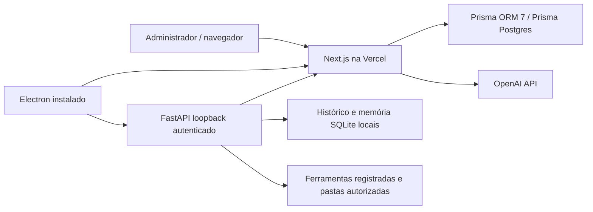

# JARVIS Cloud + Desktop — v4 em desenvolvimento

## Decisões

Monorepo npm workspaces, sem orquestrador adicional. cloud/ usa Next.js App Router, TypeScript, React e runtime Node. Prisma 7 usa prisma.config.ts, gerador prisma-client com saída explícita e PrismaPg. DATABASE_URL é uma conexão PostgreSQL TCP fornecida pelo Prisma Postgres; DIRECT_URL é usada pela CLI de migrations. O build gera o cliente, mas não executa migrations nem precisa conectar ao banco.

FastAPI foi mantido para reaproveitar memória, indexação, projetos, IDEIA.md, ferramentas de leitura e confirmações humanas. backend/ permanece na raiz como componente local; mover esses módulos agora quebraria imports, testes e empacotamento sem benefício funcional. Desktop mantém os arquivos JS, HTML e styles/ existentes. electron/ contém o ponto de entrada v4 e configuração NSIS; services/ contém login e sessões protegidas. src/, components/, assets/ foram reservados para componentes novos; os existentes não foram reescritos por estética.

desktop/electron/main.cjs inicia o código existente em modo Cloud. backend/cloud_client.py mantém o contrato AsyncOpenAI usado pelo chat/indexador, mas envia chamadas exclusivamente a /api/v1 no servidor Cloud. A credencial individual é desencriptada somente no processo principal e entregue ao serviço local em endpoint privado autenticado, ausente das listas IPC do renderer e das ferramentas da IA. O processo local mantém essa credencial em memória. A chave OpenAI nunca é entregue ao desktop.

O painel usa APIs com autorização própria; o layout é uma proteção de navegação adicional. ADMIN administra somente funcionários cujo managerId é seu ID. SUPER_ADMIN cria administradores. EMPLOYEE usa o produto desktop, sem acesso administrativo. Históricos/conversas permanecem locais; o servidor recebe contexto necessário ao pedido e persiste apenas métricas e auditoria, sem conteúdo integral. Não há acesso local a PostgreSQL.

## Estado e limites atuais

A estrutura e os fluxos existem em código e testes locais. Não equivalem à implantação completa. A API de chat suporta streaming/cancelamento; o renderer recebe deltas por IPC restrito, exibe texto durante a geração e sanitiza Markdown ao finalizar. O botão Parar cancela a chamada local e a transmissão Cloud. A interface administrativa lista até 100 registros recentes, sem paginação; consumo possui filtros por cliente e período. Recuperação de senha, MFA, transferência de funcionário entre administradores, migração humana de cofres portáteis continuam pendentes. Sessões de login substituem ativação e licenças. A renovação antecipada da sessão e as configurações globais estão implementadas. A raiz do Cloud é protegida pelo layout administrativo; não há site público. A voz central é opcional, desabilitada por padrão e tem limite conservador de caracteres; não há contagem de tokens do áudio binário inventada.

Nenhum instalador v4 foi certificado em Windows limpo. Ferramentas de escritório preservam as capacidades existentes de escrita/análise pelo chat; não foi adicionado controle nativo de Office ou terminal arbitrário.
