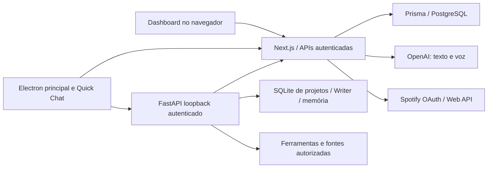

# Arquitetura — JARVIS v5

## Responsabilidades e localização

| Diretório | Responsabilidade |
| --- | --- |
| `cloud/app/` | Rotas App Router, dashboard e APIs. |
| `cloud/components/` | Interface administrativa, dados compartilhados, credenciais e consumo. |
| `cloud/lib/` | Autenticação, política, cotas, armazenamento, provedores e Spotify. |
| `cloud/prisma/` | Schema, migrations revisadas e seed sem senha fixa. |
| `cloud/test/` | Contratos, segurança, serviços e PostgreSQL embarcado. |
| `desktop/electron/` | Entrada Cloud e configuração de empacotamento Windows. |
| `desktop/services/` | Sessão individual protegida e transporte Cloud/stream local. |
| `desktop/` e `desktop/styles/` | Janelas, preloads, chat, Quick Chat, clipboard, Writer e integração visual. |
| `backend/` | FastAPI, projetos/memória locais, Writer, ferramentas e adaptadores Cloud. |
| `packages/shared/` | Schemas, tipos e constantes comuns. |
| `tools/` | Iniciadores, validação, auditoria e compilação; não é runtime Cloud. |
| `docs/` | Guias vigentes; `docs/history/` guarda registros antigos. |

Os módulos existentes permanecem em seus caminhos porque imports Python, preloads, fixtures e o empacotamento dependem deles. Não há segunda implementação de chat, Spotify ou voz criada para o Quick Chat. `Backup/` é somente leitura e nunca é importado em runtime.

## Sessão e fronteiras

O Electron principal protege a sessão individual com safeStorage/DPAPI. Renderers usam preloads e IPC com origem, frame, papel e parâmetros validados. A senha não é persistida. FastAPI recebe a sessão em memória por um endpoint privado autenticado e escuta somente loopback; não recebe chaves dos provedores. Produção usa HTTPS.

OpenAI e PostgreSQL são acessados exclusivamente pelo Cloud. As APIs verificam sessão e permissões independentemente da proteção de navegação. ADMIN administra apenas seus EMPLOYEE; SUPER_ADMIN possui o escopo global autorizado. Contas administrativas ativas podem entrar no Desktop sem alterar seu papel.

O arquivo `cloud-session-v4.bin` mantém o nome por compatibilidade das instalações existentes. Ele não indica que a versão do produto é v4. Renomeá-lo sem migração perderia a restauração da sessão; esta finalização não faz essa alteração.

## Dados e fluxos

Chats gerais e o Quick Chat geral fixo são persistidos no PostgreSQL por conta. Projetos, chats de projetos, memória, documentos e revisões Writer ficam no SQLite local do projeto. Contexto autorizado é enviado ao Cloud no pedido do usuário. Regras detalhadas em [CHATS.md](CHATS.md), [WRITER.md](WRITER.md) e [SECURITY.md](SECURITY.md).

`DashboardDataProvider` e `useDashboardData` mantêm cache em memória no layout administrativo, deduplicam consultas e aguardam os dados antes de exibir a página. Filtros de consumo têm chaves separadas; salvamentos e Atualizar renovam os recursos necessários. Segredos nunca entram nesse cache.

O processo principal mantém o único serviço de clipboard e atribui cada notificação atomicamente a um dos chats. O Writer é uma conversa padrão com preview lateral, não um aplicativo separado. Spotify usa o mesmo serviço Cloud para chat, Quick Chat e voz; comandos locais determinísticos e interpretação estruturada respeitam as mesmas permissões e cotas.

## Qualidade e distribuição

A versão dos manifests e locks é conferida contra `VERSION` pelo verificador de repositório. O rodapé administrativo lê o manifesto, evitando rótulo de versão antigo. `npm run check:v5` reúne os testes e os sete smokes Electron. O runner inicia somente entradas de teste registradas, limpa o modo Node herdado de hosts Electron e não usa perfis pessoais.

O pipeline Windows só empacota após essa validação. PyInstaller gera o backend e electron-builder gera NSIS; a auditoria compara fontes, configuração Cloud e proíbe arquivos privados no artefato. Não se publicam instaladores, tags ou credenciais automaticamente. Consulte [VALIDATION.md](VALIDATION.md) e [PUBLISH.md](PUBLISH.md).
