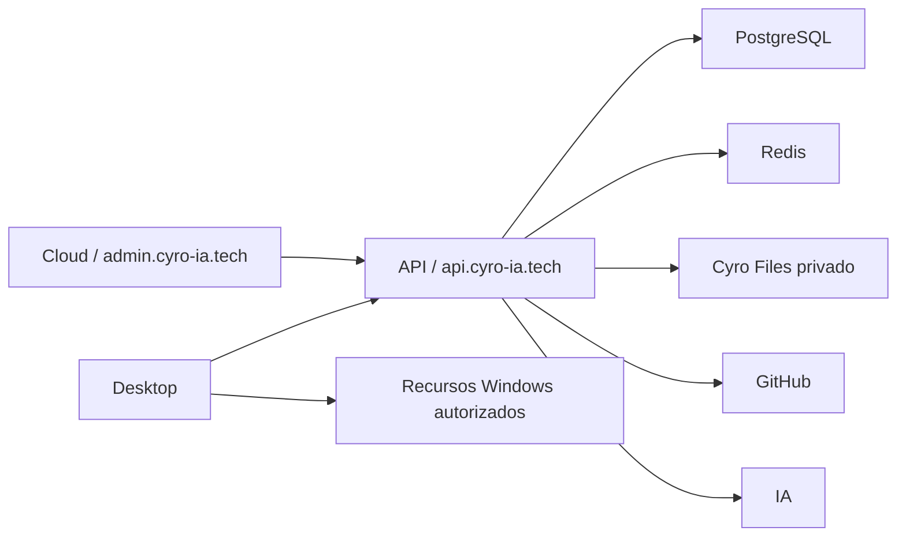

# Cyro EV v8.0.0 — desenvolvimento

Versão de trabalho: **8.0.0-alpha.0** em API, Cloud e Desktop; Files permanece 0.2.0.
A fundação inclui categorias/capacidades, catálogo central de projetos e default GENERAL
no catálogo local v4. Livro, Logistics, interfaces e migração de conteúdos estão pendentes.
Leia cyro-backend/docs/ev/ARCHITECTURE.md e TEST_RESULTS.md para escopo e evidências.
Os quatro repositórios continuam independentes, sem publicação ou migration de produção.

## Referência da organização v7

# Cyro IA v7 — organização dos projetos

Versão em desenvolvimento: **7.0.0-alpha.0**. Files evolui independentemente para **0.2.0**, com suporte restrito aos instaladores. Esta pasta reúne quatro repositórios Git independentes; não é um monorepo e não tem instalação compartilhada entre produtos.

| Pasta | Responsabilidade | Produção |
|---|---|---|
| cyro-desktop | Electron, interface, Quick Chat, voz/captura local, IPC, Writer e recursos Windows | Windows; comunica diretamente com a API |
| cyro-cloud | Painel Next.js, apresentação e transporte HTTP; sem regras de negócio ou segredos de serviços | https://admin.cyro-ia.tech — Vercel |
| cyro-backend | Autenticação, autorização, usuários, dados, IA, integrações, credenciais e atualizações | https://api.cyro-ia.tech — VPS/Coolify |
| cyro-files | Arquivos privados, quotas, disco e isolamento entre aplicação/cliente/proprietário | Serviço existente na rede Docker privada da VPS |



O Desktop não chama o painel Cloud. O painel apresenta os dados e encaminha pedidos para a API, que decide sessões, permissões e regras. A camada HTTP do Next.js no painel só preserva cookies/streams e encaminha rotas permitidas; não é um segundo backend. O envio de Setup.exe vai diretamente do navegador à API, evitando o limite de uploads da Vercel. Files não recebe chamadas diretas do Desktop/navegador.

## Comandos da pasta principal

Requer Node.js 24 LTS, indicado nos arquivos .nvmrc. Nenhuma instalação global é alterada pelas ferramentas. Se necessário, CYRO_NODE pode apontar para um executável Node 24 já instalado.

```powershell
python cyro.py inventory
python cyro.py contracts
python cyro.py install
python cyro.py test-integration
python cyro.py doctor --api-origin https://api.cyro-ia.tech --cloud-origin https://admin.cyro-ia.tech
```

`install` executa npm ci em cada raiz e nas ferramentas de integração, mantendo locks separados. Dependências Python do Desktop continuam em cyro-desktop/backend/requirements-dev.txt. `doctor` só consulta /health, sem autenticar usuários, alterar dados ou executar deploy. Logs/resultados dos testes isolados ficam em .cyro, fora dos quatro repositórios.

Para conferir configurações privadas sem exibir valores:

```powershell
python cyro.py production-check --backend-env CAMINHO_PRIVADO_BACKEND --files-env CAMINHO_PRIVADO_FILES --cloud-env CAMINHO_PRIVADO_CLOUD
```

A validação compara as chaves entre serviços, domínios e separação dos bancos. Não conecta ao banco nem aplica migrations. Use os arquivos .env.production.example de cada projeto como referência e configure os valores diretamente no Coolify/Vercel. Não existem comandos automáticos de deploy, reset ou criação de infraestrutura nesta ferramenta.

## Desenvolvimento e testes

Os serviços de produção já existentes serão reutilizados. Nenhum PostgreSQL, Redis ou Files local foi provisionado. Os testes automatizados usam portas, banco embarcado e disco temporários exclusivamente para testar o protocolo sem tocar na produção.

- Backend: npm test, npm run typecheck, npm run build, npm run test:http.
- Cloud: npm test, npm run build, npm run test:layout.
- Desktop: npm run check:v7; o nome check:v6 continua por compatibilidade.
- Files: npm run build, npm run sdk:build, npm test. Testes PostgreSQL/Redis reais exigem variáveis dedicadas de teste, nunca os bancos de produção.

O teste integrado atravessa Cloud → API → Prisma e API → SDK → Files → disco, além de usar o cliente Desktop no Electron. O GitHub é simulado: nenhuma tag/release real é criada. PostgreSQL embarcado e Redis de teste não equivalem a homologação da VPS.

## Funcionalidades e módulos

Desktop: desktop/scripts/app e session (entrada/login), chat/workspace/quick (conversas e Quick Chat), writer (editor), integrations (IPC Spotify), updates (atualizador), backend/ (runtime Python local e ferramentas autorizadas). O nome histórico backend/ dentro do Desktop não é o serviço central da VPS e permanece por compatibilidade.

Backend: app/api/auth e device (sessões), admin/management/provider-settings (administração), v1 (IA/áudio), integrations (Spotify), files (arquivos privados), releases/updates (publicação e distribuição), system/status (diagnóstico). lib/ concentra regras e adaptadores; prisma/ concentra schema e migrations. A configuração GitHub é protegida junto das demais credenciais.

Cloud: app/ e components/ compõem páginas e estados visuais; lib/backend.ts é transporte para a API; lib/auth.ts consulta a sessão central. Credenciais e Versões são interfaces das operações do Backend.

Files: src/routes, services, repositories, storage e security separam HTTP, regras de arquivos, persistência, disco e autenticação de serviço. sdk/ continua um pacote independente, com snapshot oficial versionado no Backend.

Os READMEs dos projetos apontam para os guias atuais de produção e atualizador. A documentação 6.x foi preservada como histórico, não como configuração vigente da v7. A centralização/importação dos históricos de projetos locais é uma etapa separada: esta organização não envia esses dados automaticamente nem elimina recursos locais.

## Após clonar os quatro repositórios

As ferramentas e este documento são versionados em cyro-desktop/tools/platform e cyro-desktop/docs/v7. Execute `python cyro-desktop/tools/platform/bootstrap.py` para recriar os atalhos desta pasta. Os repositórios, remotos e históricos permanecem separados.
